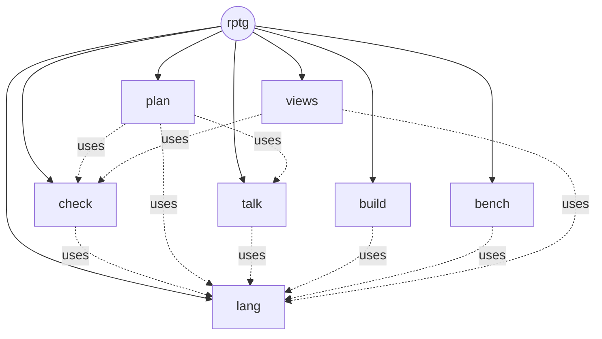

# Карта rptg — выход архитектора

**27.09.2026.** rptg описан собственным методом: задача «К карта» и разложение корня.

* **Формальная часть** лежит рядом:
  * [types.yaml](types.yaml) — 83 типа;
  * [rptg.yaml](rptg.yaml) — карточка корня, 7 подсистем уровня 2, схемы потоков;
  * [project.yaml](project.yaml) — настройки проекта rptg.
* **Проверена** прототипом проверок [tools/selfcheck.py](../tools/selfcheck.py). Итог — в
  [SELFCHECK.md](SELFCHECK.md): 0 нарушений на 41 операции, 89 условиях и 74 примерах. Сам
  прототип проходит 17 контрольных случаев четырёх видов
  ([tools/selfcheck_cases.py](../tools/selfcheck_cases.py)).
* **Сверена с базой** (§7, §9, §10): пять находок самоописания уже были в arch0, arch1 и arch2.
  Политика эскалации переписана на языке комплексов arch2.

По методу дальше идёт **утверждение карты пользователем** (MAP_REVIEW). После него конструкторы
раскладывают подсистемы — формальные карточки уровней 3–5. Ниже эти уровни показаны эскизом,
как положено общей карте сети.

---

## 1. Главный разрез: ядро по методу, оболочка руками {#cut}

Схемы потоков MVP не умеют трёх вещей, без которых rptg не работает:

* **ветвиться** — выбор по значению делает только функция листа;
* **повторять до условия** — есть отображение и свёртка по списку, но нет цикла «пока не готово»;
* **общаться с миром** — эффекты ограничены `fs.read`, `fs.write`, `stdout`, `clock`, `random`.
  Нет сети, процессов, сервера.

А конвейеру rptg нужен цикл до конца работы, вызовы моделей по сети, песочница-процесс и окно.

Поэтому rptg разрезан так:

* **ядро** — чистые функции, строится методом. Эффектов нет во всём дереве, часов ядро не
  видит;
* **оболочка** — ~1000 строк, пишется вручную вне метода. Её граница — девять операций корня.

Это обычная схема «функциональное ядро — императивная оболочка»: ядро решает, оболочка исполняет.
**Разрез не новый — так устроены arch0 и arch1:**

* «ядро не импортирует адаптер модели, адаптер возвращает сырьё и не разбирает» — arch0
  MODEL_INTERFACE §4, API_BOUNDARIES;
* уровни 0–6 со STORAGE внизу и ORCHESTRATOR наверху — arch1/CLAUDE.md.

arch2 оркестратор сознательно не строил: «не выводится ни из одного факта» (SPEC §11). У rptg
оркестратор есть, но это решение о продукте, а не вывод из опытов.

```python
# вся оболочка по смыслу — цикл и исполнители действий
while True:
    action = core.plan_next(state, cfg, table)
    if action["kind"] == "stop":
        break
    if action["kind"] == "call_model":
        req = core.render_call(action["task"], state, cfg)
        raw = host.llm.send(req)                        # сеть, ключи — только здесь
        event = {"kind": "model_answered", "task": action["task"],
                 "answer": core.read_answer(req["provider"], raw)}
    elif action["kind"] == "run_sandbox":
        files = core.build_files(state, action["target"], cfg)
        event = {"kind": "sandbox_finished", "target": action["target"],
                 "output": host.sandbox.run(files, action["run"])}   # процесс, тайм-аут
    else:                                               # ask_user, pause
        event = host.ui.ask(action)
    tr = core.apply_event(state, event, cfg)
    host.store.append(tr["journal"], stamp=host.clock())   # время ставит оболочка
    state = tr["state"]
```

| часть оболочки | эффект | строк (оценка) |
|---|---|---|
| `host.cli` — команды | stdout | 150 |
| `host.loop` — цикл выше, возобновление | — | 60 |
| `host.store` — `.rptg/` и `~/.rptg/`, атомарная запись, журнал | fs | 200 |
| `host.llm` — SDK Anthropic, OpenAI, Google; OpenAI-совместимые; llama.cpp | сеть, процесс | 250 |
| `host.sandbox` — временная папка, подпроцесс Python, тайм-аут, чистое окружение | процесс, fs | 150 |
| `host.gui` — локальный сервер и страница | сервер | 250 |

---

## 2. Корень `rptg`: девять операций ядра {#root}

| операция | что делает | когда зовёт оболочка |
|---|---|---|
| `plan_next(state, cfg, table) → Action` | следующее действие: модель, песочница, вопрос, пауза, конец | в начале каждого круга |
| `apply_event(state, event, cfg) → Transition` | все проверки события, новое состояние, записи журнала | после каждого действия |
| `render_call(task, state, cfg) → ProviderRequest` | подсказка и запрос поставщику без ключей | перед вызовом модели |
| `read_answer(provider, raw) → RawAnswer` | разбор конверта: текст, токены, причина остановки, отказ | после вызова модели |
| `build_files(state, target, cfg) → FileSet` | тесты функции, пакет узла, вся программа | перед песочницей и в конце |
| `calibration_plan(reference, operators, cfg) → CalibrationPlan` | раздел набора и задачи калибровки | `rptg models calibrate` |
| `competence(results, plan, cfg) → Competence` | таблица компетенций и гейт G0 | после калибровки |
| `selftest(cases, cfg) → SelftestReport` | контрольные случаи всех проверок | `rptg selftest`, CI |
| `view(state, query, cfg) → View` | представления для окна и командной строки | окно, `rptg status` |

**Приёмочные примеры корня** — сквозной пример метода из LOGIC §9, теперь как тест самого rptg:

* новый проект → первая задача архитектору;
* ответ без JSON → повтор формы, попытка содержания не тратится;
* разложение `app.billing` с дырой в валютах → П4 провален с контрпримером EUR/USD. Подтип
  `dependency` дорогой, поэтому по политике (LOGIC §7.3) элемент сразу уходит на следующую
  ступень, `grok`, с самодостаточным отчётом;
* карта на утверждении → вопрос пользователю с хэшем разложения.

После утверждения карты эти примеры становятся примерами пользователя (I15).

---

## 3. Подсистемы уровня 2 {#level2}



Сплошные рёбра — разложение, пунктир — `uses` (кто чьи операции вызывает). Циклов нет. `lang` —
основание, от него зависят все. `plan` стоит выше всех, потому что решает.

| узел | est_lines | операций | uses | в двух словах |
|---|---|---|---|---|
| `rptg.lang` {#lang} | 1500 | 13 | — | язык условий и типов, канон и хэш |
| `rptg.check` {#check} | 1600 | 7 | lang | все проверки, приёмка, отчёт, устаревание, контрольные случаи |
| `rptg.plan` {#plan} | 1200 | 4 | check, lang, talk | очередь, маршрут, машина состояний, эскалация, бюджет |
| `rptg.talk` {#talk} | 700 | 4 | lang | подсказки, запросы и ответы поставщиков, цена |
| `rptg.build` {#build} | 900 | 1 | lang | текст файлов целевой программы и тестов |
| `rptg.bench` {#bench} | 250 | 2 | lang | калибровка операторов |
| `rptg.views` {#views} | 400 | 1 | check, lang | представления |

Все семь — составные: у шести есть `uses` (правило 3), у `lang` 13 операций (правило 4).

---

## 4. Эскиз сети до листьев {#sketch}

Это общая карта: имена, размеры, вид по правилам LOGIC §6.2 при `final_max_lines: 60`.
Формальные карточки этих узлов пишут конструкторы после утверждения.

Обозначения:

* **Ф** — финальный узел (функции пишут исполнители);
* **С** — составной;
* **\*** — предел сложности блока Э1 ослаблен вручную в `project.yaml` (находка С-5). Предел строк
  с 28.09.2026 — функция договора, вручную не ослабляется (§11).

```
rptg ................................................ С 7000  (уровень 1)
├─ lang ............................................. С 1500
│  ├─ cl  (условия) ................................. С 1050
│  │  ├─ parse ...... текст → дерево разбора ........ Ф* 180
│  │  ├─ typecheck .. типы узлов, ошибки с позицией . Ф* 200
│  │  ├─ measure .... узлы, кванторы, нелинейность .. Ф   40
│  │  ├─ evaluate ... вычисление на данных, без eval  Ф* 150
│  │  ├─ python ..... выражение Python для обёрток .. Ф* 120
│  │  ├─ logic ...................................... С  300
│  │  │  ├─ smt ..... факты и цель → текст SMT-LIB .. Ф* 200  (уровень 5)
│  │  │  ├─ solve ... z3 с пределом rlimit .......... Ф   60
│  │  │  └─ decode .. модель z3 → контрпример по путям Ф  40
│  │  └─ strategy ... стратегии Hypothesis ......... Ф   60
│  ├─ types  (env, path, sub, validate, size) ....... Ф  280  — пять функций, сначала целиком
│  └─ canon  (canonical, digest) .................... Ф   80
├─ check ............................................ С 1600
│  ├─ answer  П1: extract · shape · normalize ....... С  220
│  ├─ graph   П2: tree · flows · scope · progress · ownership · reach · impact  С 350
│  ├─ contract П3–П5, П7: edges · data · facts* · logic · examples   С 350
│  ├─ code    Э1 и прогоны: ast_rules · size · mypy_read · runs_read · blame   С 300
│  ├─ verdict приёмка: accept · report · order ...... С  200
│  └─ cases   контрольные случаи: pick · summarize .. С  100
├─ plan ............................................. С 1200
│  ├─ route   kind · work · prior · masks · table · ladder · decide   С 400
│  ├─ queue   designs · functions · assemblies · approvals · merge  С 250
│  ├─ machine violation · same · escalate · states* · children · stops · phase   С 400
│  ├─ pick .......................................... Ф   60
│  └─ budget ........................................ Ф   40
├─ talk ............................................. С  700
│  ├─ prompt  prefix · map · design* · function · repair · alt · assemble   С 400
│  ├─ providers anthropic · openai · google · llamacpp · select   С 250
│  └─ cost .......................................... Ф   40
├─ build ............................................ С  900
│  ├─ types ...... TypeDef → dataclasses ............ Ф* 120
│  ├─ flows ...... order · stmt · module ............ С  250
│  ├─ wrappers ... обёртки условий .................. Ф   80
│  ├─ tests ...... examples · properties · runner ... С  250
│  └─ layout ..... paths · leafmod · package ........ С  150
├─ bench  split · tasks · cells · gate .............. С  250  — четыре финальных
└─ views  status · node · graph(nodes, edges) · competence · select  С 400
```

**Итог эскиза:** около 116 узлов, из них около 91 финального. Глубина — 5 уровней, в ветви
`lang.cl.logic`. Дерево не укладывается в три уровня — ровно то, что было поправлено в методе.

---

## 5. Кто что строит {#routing}

По `project.yaml` и прикидке ([SELFCHECK.md](SELFCHECK.md)):

* **Карту (эту)** — архитектор.
* **Подсистемы уровня 2** раскладывает `opus` — ручное назначение `level:2`. Это метапрограмма,
  а малые планировщики промахиваются (LIFE-9: 22 %). Без назначения прикидка отдала бы `lang`,
  `check` и `plan` (S_раз 64–68) второй ступени, `grok`, а остальные — первой, `gemini`.
* **Уровни 3–5** — по прикидке и лестнице конструкторов, пока нет калибровки разложений.
* **Функции** — по таблице компетенций после `rptg models calibrate`, до неё — по прикидке.
  Рекурсивные алгоритмы (`parse`, `typecheck`, `evaluate`, `python`, `smt`, `facts`,
  `build.types`) — самые трудные листья. Разумно закрепить их за сильной моделью вручную.

---

## 6. Порядок постройки {#order}

Зависимости задают порядок снизу вверх:

1. **`lang`** — от него зависят все. Начать с `canon`, `cl.parse`, `cl.evaluate`: они уже
   есть в прототипе `tools/selfcheck.py`.
2. **`check`** с контрольными случаями — после этого rptg проверяет собственную карту сам, и
   прототип больше не нужен.
3. **`talk` и `build`** — независимы, параллельно.
4. **`plan`** — мозг, ему нужны `check` и `talk`.
5. **`bench`, `views`** — последними.
6. **Оболочка** — параллельно с `plan`: ей нужны только договоры корня.

---

## 7. Находки самоописания — после сверки с базой {#findings}

Описать rptg его же методом — хорошая проверка метода. Мест нашлось тринадцать. Сверка с базой
показала: **пять из них уже были в экспериментах** — я открыл их заново, а должен был взять
готовыми. Они помечены в столбце «в базе».

| № | что всплыло | в базе | что сделано |
|---|---|---|---|
| С-1 | схемы потоков без ветвлений, циклов, эффектов сети и процессов не описывают оркестратор | **было в arch2**: язык комплексов CALL, CHECK, SEQ, PAR, SWITCH, BUDGET, STOP, ASSEMBLE. SWITCH — ветвление по закрытому списку наблюдаемых. Циклы исключены сознательно: иначе нет статической оценки стоимости и гарантии BUDGET | предложение «ограниченный цикл» снято. Политика эскалации переписана генотипом arch2 (LOGIC §7.3). Оболочка остаётся вне метода — у неё сеть и процессы |
| С-2 | языку типов не хватило непрозрачного значения, словаря, источника «строка или литерал», простых типов в параметрах, ссылки по имени | нет | `Json`, словари, `oneOf` для `Source`, встроенные `Decimal` и `Json`; на утверждение |
| С-3 | CL не хватило `ключ in словарь` и `==` для логических значений | нет | на утверждение |
| С-4 | сложный результат нельзя сравнить целиком | нет | `match: subset` и `"*"`; на утверждение |
| С-5 | функции листа не вызывают друг друга → рекурсивный алгоритм не делится на куски по 40–60 строк | нет | ручные `max_lines` и `max_complexity` на 7 узлах; «лист-модуль» — открытый вопрос |
| С-6 | тайм-аут Z3 по часам делает вердикт зависимым от машины | **принцип был в arch2**: семантика детерминирована, стохастика только внутри CALL, время пишется в трассу и в вердикт не входит | `z3_rlimit` — детерминированный предел; время пишет оболочка |
| С-7 | объекты Z3 — не JSON, между узлами их не передать | нет | текст SMT-LIB, решатель — в отдельном листе |
| С-8 | без ветвлений схема не выбирает, какую проверку звать | частично: в arch2 выбор делает SWITCH политики | «вычислить всё, выбрать в листе» — только в схемах продукта |
| С-9 | хэш разложения не включал карточку узла и узлов `uses`, и старое доказательство оставалось «текущим» | **было в arch0 и arch1**: STALE распространяется при смене версии источника (STATE_MACHINE §4, I-5), старое доказательство протухает по водяному знаку (arch1, state_engine) | это не находка, а регресс LOGIC v0.3; исправлено возвратом к принципу arch0 |
| С-10 | у элемента не было состояния «ждёт утверждения» | нет | добавлено `approval` |
| С-11 | не было записи предмета работы | нет | `вид:узел[:операция]` |
| С-12 | прототип превратил сбой собственной проверки в «нарушение карты» | **было в arch0, arch1, эксп. 11–12**: ERROR ≠ FAIL — сбой проверки даёт UNKNOWN, иначе её баги становятся ложными дефектами (SEAM_MODEL §4, F45) | исправлено: сбой проверки — отдельный ERROR, код выхода 2 |
| С-13 | контрольные случаи прототипа были только «заведомо неверные» | **норма arch1**: для каждого шва три вида — заведомо верный, заведомо неверный, неприменимый (WORK_PLAN, этап 3). F10: строгость проверки не означает её правильности | добавлены все три вида (`tools/selfcheck_cases.py`). **Заведомо верная карта сразу поймала 2 ложных отказа** в П3 — их скрывало прежнее «13 из 13» |

**Итог:** 17 контрольных случаев — 2 заведомо верных, 1 неприменимый, 13 заведомо неверных, 1 на
сбой проверки. Проходят все. Карта rptg — 0 нарушений.

---

## 8. Что утверждается {#approval}

1. Разрез: ядро по методу, оболочка руками (§1).
2. Девять операций корня и их приёмочные примеры (§2).
3. Семь подсистем, их договоры и рёбра `uses` (§3).
4. Политика эскалации — генотип на языке arch2, умолчание выведено из измеренного (LOGIC §7.3).
5. Поправки метода С-2 — С-5, С-7, С-11. С-9, С-10 и С-12 — ошибки, они уже исправлены.
6. Назначение `opus` на разложение уровня 2 и ручные пределы для рекурсивных листьев.

После «да» — разложение семи подсистем (формальные карточки уровня 3) и первый код: перенос готового
из arch1 и arch2 (§9), затем `lang`.

---

## 9. Что берётся готовым из arch0, arch1, arch2 {#reuse}

Большая часть механики rptg в проекте уже написана и проверена контрольными случаями: у arch1 их
91, у arch2 — 152. Переносить её нужно вместе с этими случаями.

| подсистема rptg | что берётся | откуда |
|---|---|---|
| `lang.canon` | каноническая запись, хэш, атомарная запись только-дописыванием | arch1 `storage.py`; трассы arch2 |
| `check` | реестр проверок с `self_test` и `is_trusted`; ERROR ≠ FAIL; три вида контрольных случаев; извлечение внутри проверки | arch1 `seam_engine.py`, `seams/`, `tests/seam_control_cases/`; arch2 `registry.py` |
| `check` (устаревание) | распространение STALE, водяной знак доказательств | arch1 `state_engine.py`, `graph_core.py` |
| `plan` (политика) | язык генотипа; валидатор — типы, `default` у SWITCH, конечность, верхняя оценка стоимости; исполнитель с гарантией бюджета и полной трассой | arch2 `genotype.py`, `runner.py` |
| `plan` (состояния и ремонт) | переходы состояний, три множества ремонта, STOP-условия | arch1 `state_engine.py`, `repair_planner.py`, `policy.py` |
| `plan` (наблюдаемые) | `same_failure`, подтип нарушения | эксп. 12: `outcome_classification.py`, `seams.py` (`collision_subtype`) |
| `talk` | сборка контекста под действие, без прежнего ответа | arch1 `context_builder.py` |
| `bench` | повтор по записанному без токенов, фитнес по Парето, живое подтверждение | arch2 `replay.py`, `fitness.py`; стенды эксп. 11–14 |
| оболочка | исполнитель действий с сохранением сырья до разбора, адаптер модели, оркестратор | arch1 `action_executor.py`, `model_adapter.py`, `orchestrator.py` |

Предмет у arch1 и arch2 другой — утверждения задач, а не карточки программы. Поэтому переносится
механика, а не содержимое. Насколько это сократит MVP, станет ясно при переносе. Но переносить код
вместе с его контрольными случаями дешевле, чем писать заново.

---

## 10. Главный риск: это направление A-2 {#risk}

В базе есть **четыре независимых вердикта «не переходить к A-2»** — к графу, который строит модель:

* arch1 REPORT;
* эксп. 11, §20;
* эксп. 12, §16;
* эксп. 12 v2.

Их повторяет arch2 SPEC §11. Мотивация A-2 была такой: граф даёт ремонту полезный контекст. Она не
подтвердилась: структурный контекст дал +0,6 п.п. при p = 0,845 и обошёлся дороже по токенам, а
нужная ситуация возникала лишь в 18,9 % реальных отказов.

rptg строит граф моделью — то есть идёт ровно туда. Разница в роли графа:

* у rptg граф — не подсказка для ремонта, а устройство программы, которая не помещается в одно окно
  (SWE1: +0,222);
* каждое ребро этого графа проверяется HARD;
* довод «граф помогает чинить» rptg не использует.

Но главный вопрос — годится ли граф, который строит модель (OQ-DEC-1), — не измерен ни разу.
Четыре вердикта — повод мерить его первым (BASIS §4, замер 3).

---

## 11. Первый код: `lang` {#lang}

**Что построено.** Поддерево `rptg.lang` разложено до пятого уровня: 5 файлов разложения, 4
составных узла, 14 листьев. Код листьев написан по карточкам — по одной функции на операцию, как
требует Э1, всего 1625 строк.

* Обвязку составных узлов генерирует [tools/codegen0.py](../tools/codegen0.py) — затравка
  `rptg.build`. Каждый составной узел получает `__init__.py` (операции в обёртках условий),
  `_flows.py`, `_leaves.py` и `_types.py` с dataclasses. Условия в Python переводят сами листья
  `lang`: скрипт собирает себя своими же листьями.
* Общий код исполнения:
  * [rptg/_contract.py](../rptg/_contract.py) — обёртки условий, первое нарушение называет
    виновного;
  * [rptg/_values.py](../rptg/_values.py) — JSON ↔ dataclasses на границе ядра.
* [tools/leafcheck0.py](../tools/leafcheck0.py) — затравка Э1: строки, сложность по таблице из
  документации radon, импорты, запрещённые встроенные, подписи по карточкам.

**Что проверено** (`python -m pytest tests`):

| проверка | итог |
|---|---|
| примеры карточек через обёртки условий (Э2 на собранном коде) | 54 из 63; 9 ждут z3 |
| условия всей карты проходят разбор и типы (П1) | 138 из 138 |
| два исполнения условия — обход дерева и перевод в Python — совпадают на точных примерах всей карты | 82 из 82 |
| контрольные случаи языка: неверные условия отвергнуты с причиной, тонкие верные приняты | 74 из 74 |
| контрольные случаи затравки Э1 — верный лист, девять неверных, неприменимое правило, числа сложности | 16 из 16 |
| обёртки условий называют сторону и первое нарушение; значения всех примеров карты переживают перевод JSON → объекты → JSON | 383 из 383 |
| контрольные случаи прототипа проверки карты | 18 из 18 |
| обвязка не отстала от карты | да |
| статика листьев (Э1): до 28.09 — константа 60 строк; с 28.09 — функция договора | 13 из 14 → 14 из 14 листьев |

**Находки сборки:**

* **Н-1. Параметр `result`.** У `decode.proof` и `decode.sat` параметр назывался `result`, а это
  имя результата в `ensures`. Условие `result.verdict == "refuted"` становилось неоднозначным, и
  прототип проверки этого не ловил: словарь окружения молча брал последнее значение. Дефект нашла
  генерация обвязки. Параметр переименован в `answer`, в П1 прототипа добавлено правило: имя
  параметра — не `result` и не слово Python.
* **Н-2. Словари вместо dataclasses.** Сначала листья были написаны на словарях. Утверждённая карта
  при этом говорит «типы как dataclasses», а LOGIC Э6 — «запись — конструктор». Расхождение поймал
  пример `cl_python` (`l.qty`) из утверждённого корня. Пример написан моделью, но утверждён вместе с
  картой. Листья переписаны на объекты. Поле, чьё имя — слово Python, в объекте называется `in_`,
  в JSON — `in`.
* **Н-3. Корневые примеры уточнили язык:**
  * имена в мерах идут по алфавиту;
  * `Decimal` и `Json` встроены в язык типов;
  * в пути `type_path` допустим индекс `[N]`.
* **Н-4. Э1 перестроил два узла.**
  * Кодировщик SMT занял 301 строку при ручном пределе 220. Неявные факты из схем типов вынесены в
    лист `schema`, кодировщик сократился до 217 строк.
  * Стратегии Hypothesis заняли 96 строк при пределе 60. Узел повышен до составного: `bounds` —
    38 строк, `gen` — 59.

  Поводом для обеих правок был предел, а не необходимость. Кодировщик и факты типов — разные
  работы, их разделение оправдано и без предела. Границу в стратегиях провёл именно предел. База
  предупреждает, что такая раскладка не бесплатна (F28, LIFE-9), а сам предел не измерен — это
  допущение А10 в [BASIS](../docs/BASIS.md).
* **Н-5. Одна операция кодировщика.** Кодировщик — одна операция над одним условием вместо
  `encode_prove` и `encode_sat`: функции листа не вызывают друг друга (С-5). Список условий
  кодирует отображение в схеме потока.
* **Н-6. Деление на ноль и индекс вне списка в SMT.** Они кодируются формулой «определено» с
  коротким вычислением связок. Поэтому `x != 0 => y / x > 1` при `x = 0` истинно — так же, как
  при исполнении. Без этого П4 опровергал бы верные условия.

**Сверка с базой PTG** (27.09, после сборки):

* **jsonsubschema один П3 не закроет.** ARCHITECTURE §10 выбрала его для П3, а я написал свой
  подтип, не проверив инструмент, — это отступление. Сверка по исходному коду показала, что свой
  подтип нужен всё равно: jsonsubschema знает только Draft-04 и отвергает рекурсивные ссылки
  (`UnsupportedRecursiveRef`). В карте таких типов 9 из 100, среди них `Config`. Внесено в BASIS
  §1.5.
* **Свои обёртки условий** вместо декораторов icontract или deal из REVERSE-PTG-VERIFICATION §3.
  ARCHITECTURE и LOGIC пишут «обёртка от codegen», так что утверждённому это не противоречит. Но
  Э4 (CrossHair, v0.1) наших обёрток не поймёт: к v0.1 их надо генерировать в понятной ему форме.
  Внесено в BASIS §3.
* **Обращение к z3 ничем не подкреплено.** В экспериментах базы z3 не использовался ни разу, на
  диске его нет. `from_string` с именованными утверждениями, `rlimit` и `unsat_core` проверят только
  9 отложенных примеров. Внесено в BASIS §3.
* **Нарушение нормы трёх видов контрольных случаев — моё.** У затравки Э1 их не было вовсе. Первый
  же верный случай нашёл дефект: сгенерированные типы разрешались только из пакета `rptg`, и лист
  любого другого проекта падал бы ложно. Сложность считалась не по radon: `with` не учитывался,
  лямбды выпадали. Не было случаев и у нового правила П1, у обёрток и у перевода значений. Теперь
  они есть — строки таблицы выше.
* **`canonical_json` в arch2 совпадает с `canon` буква в букву** — утверждение карточки верно.
* **Первый замер А6** — оценки размера против факта, 12 оценок, данных до кода: медиана 0,94,
  размах 0,09–1,60, одно неверное решение «целиком» (`strategy`). Внесено в BASIS §2.

**Предел Э1 — функция договора** (28.09, по указанию пользователя: «рассчитай теоретически
необходимый размер предела… возможно придется сделать функцией… применяй ко всем листьям»).
Полный вывод — `REVERSE-PTG-LIMIT-FUNCTION.md` в корне рабочей папки, он индексируется базой PTG.

* **Закон.** Строк кода ≈ 2 на решение: на 21 функции листьев 2,01·D − 3,9, R² 0,91, σ 7.
* **`schema`.** Договор требует 33 решения, необходимо ≈ 62–66 строк кода, фактически 65. Предел —
  76 строк кода. Константа 60 физических вмещает не больше ~20 решений.
* **Правило Э1 теперь:**
  * строк кода ≤ 2·D_код + S + 10;
  * D_код ≤ 1,5·D_договор + 5 там, где D объявлено.

  Применено ко всем 21 функции: нарушений 0. Пять ручных пределов строк сняты, `schema` зелёный.
* **По ходу исправлены два дефекта `types.sub`:**
  * зацикливание на кольце псевдонимов;
  * рефлексивность, сломанная сжатием под 60 строк.
* **Открыто.** Ручная разметка договорного D неустойчива (`typecheck`: 56 или 123 при 97 в коде),
  стандарт — допущение А11.

**Установка пакетов** (28.09, по указанию пользователя): z3-solver 5.1.0.0, hypothesis 6.168.3,
radon 6.0.1, mypy 2.3.1. С z3 все 63 примера карточек `lang` проходят; jsonsubschema не ставился.

---

## 12. Второй код: `check` {#check}

**Что построено** (28.09). Подсистема проверок разложена на уровни 3 и 4: 6 детей, 5 составных,
26 листьев, 30 функций, 1652 строки листьев. Обвязку сгенерировал скрипт. Проверка каждого слоя —
конвейер «лист готовит задания → схема прогоняет по ним операцию `lang` → лист выносит вердикт».
`evaluate` и `run_case` гонят один и тот же конвейер, так что контрольные случаи проверяют код,
работающий в деле. `evaluate` на сквозном примере занимает 0,1–0,16 с.

**Что проверено** (`python -m pytest tests`: 1707 из 1707 после деления `facts` 29.09):

| проверка | итог |
|---|---|
| примеры карточек `check`, включая оба примера `evaluate` корня: П1–П7 на сквозном примере, П4 через Z3 | 146 из 146 |
| контрольные случаи проверок: три вида на каждый слой П1–П5, П7, Э1–Э3, Э6 — через `run_case` | 46 из 46; `summarize` доверяет всем 10 слоям |
| два исполнения Э1 — статика в продукте и затравка `leafcheck0` — на каждой функции каждого листа | 52 из 52 |
| Э1 затравкой на всех листьях | 0 нарушений (до деления `facts` — 1) |
| контрольные случаи прототипа, включая новое правило Json | 19 из 19 |
| mypy в строгом режиме по `check` | 1094 замечания — долг, как у `lang` |

**Находки постройки** (подробно — `REVERSE-PTG-CHECK.md` в корне рабочей папки):

* **С-15. Элемент отображения — местное имя.** `args` берут поля элемента: `{map: lang:cl_prove,
  over: n2.proofs, item: o, args: {facts: o.facts, goal: o.goal, …}}`. Без этого конвейер «задания
  → операция языка» не записать. LOGIC §2.3.
* **Правило Json.** Любой тип — подтип `Json`, объект в месте `Json` записывается в JSON. Внутри
  `check` всё — JSON: ответ модели, вход контрольного случая, содержимое хэша. LOGIC §2.5.
* **Н-7. `uses` из родителя импортировался как брат** (`from .. import lang` у внука). Генератор
  делал относительный импорт; теперь импорт абсолютный.
* **Н-8. Контрпример — значения всех символов модели,** а не только цели: у обязательства П4 цель
  записана через выходы схемы, параметры операции есть только в фактах. Правка `lang.decode`.
* **Н-9. Хэш разложения брал типы самого узла** — после приёмки он бы менялся. Теперь только
  строгие предки. LOGIC §10.
* **Н-10. П1 закрывает записи схем** и запрещает переменной квантора совпадать с параметром.
* **Н-11. Неполные факты П4** (необязательное поле, словарь, составной литерал) дают `unknown`, а
  не ложный `fail`. Противоречивые условия (I14) называются раньше обязательств (I13).
* **Н-12. Данные примеров предков видны потомкам** (`tools/designs.py`). Загрузчик нашёл три
  одинаковых якоря-дубля.

**Решено пользователем 29.09.2026** («утверждаю правки 1-5, facts дели по а»). Правки корня
записаны в `design/approvals.yaml`; самопроверка теперь сверяет последнее утверждение с хэшем
карты. Поле `objection` разложения `check` снято:

1. `Config.trusted` — канал доверия от `selftest` к `evaluate`. Альтернатива — встроенные случаи в
   каждом `evaluate`: дороже и требует данных случаев в ядре.
2. `Config.contracts` — договоры Э1 в ядре: следствие правила от 28.09.
3. Примеры корня с контрпримером EUR/USD, включая пример пользователя у `apply_event`: Z3 даёт
   USD/EUR, значения произвольны — «*».
4. Пример `report`: место и фрагмент — из доказательства, без фраз «по стоимостям строк».
5. Лист `contract.facts` разделён по работам. Равенства значений по типу ушли в лист `equal`
   (вариант (а)), выполнимость условий (I14) — тем же правилом в лист `feasible`. У `contract`
   было бы восемь детей при пределе семь, поэтому листья разведены по слоям: `data` (П3),
   `logic` (П4, П5), `examples` (П7), как у `answer`, `graph`, `code`. Договорное D `facts`
   осталось 53: код теперь даёт 79 решений при допуске 84,5. D новых листьев объявлено до кода:
   `equal` — 16 (в коде 20), `feasible` — 13 (15).
6. `MapAnswer` — новый тип корня.

**Калибровка А11 после деления:** 32 функции, D_код = 1,52·D − 1,9, R² 0,962. Граница +2σ —
1,52·D + 4,7, это и есть действующее правило 1,5·D + 5. Выброс, давший прежний наклон 1,76,
был листом с тремя работами. Превышение правила — сигнал искать в листе вторую работу.

## 13. Третий код: `talk` {#talk-code}

**Что построено** (29.09). Общение с моделями — уровни 3 и 4:
* `context` — составной узел с листьями `idea`, `branch`, `leaf`, `repair`, `merge`;
* листья `schema`, `text`, `wire` (три операции), `price`.

Итого 9 листьев, 11 функций, 398 строк листьев. Подсказка собирается конвейером «факты →
схема ответа → способ вывода → текст → ключ кэша». Тексты подсказок — данные разложения
(`texts_p1`): они входят в хэш, и правка текста снимает утверждение. Сборка подсказки занимает
2–6 мс. Префикс разложения ≈ 7 КБ, карты ≈ 4,7 КБ, функции ≈ 2 КБ.

**Что проверено** (`python -m pytest tests`: 2163 из 2164):

| проверка | итог |
|---|---|
| примеры карточек `talk` | 55 из 55 после утверждения правки корня (ниже) |
| контрольные случаи `talk`: схема = схема П1, грамматика llama.cpp, правило контекста, префикс, способы, сквозной путь до П1 и Э1, края конверта, точная цена | 143 из 143 |
| мутации листов: 13 поломок правил | все 13 пойманы |
| Э1 затравкой и два исполнения Э1 | 0 нарушений; 11 из 11 |

**Находки постройки** (подробно — `REVERSE-PTG-TALK.md` в корне рабочей папки):
* **Т-1. Строгий структурный вывод Anthropic ответов rptg не вмещает.** Он принимает только
  закрытые записи без словарей и рекурсии, а в каждом ответе есть `flows`, `args`, `fields`,
  примеры и схемы типов. `json_schema` у Anthropic недоступен, исполняется `tool`; способ
  пишется в запрос. ARCHITECTURE §5.1, LOGIC §8.3.
* **Т-2. llama-cpp-python молча откатывается к «любому JSON»,** если схема не переводится в
  грамматику. Схема ответа пишется со ссылками `#/$defs/…` (запись ядра `{$ref: Имя}` перевод не
  принимает), оболочка переводит сама, контрольный случай держит перевод.
* **Т-3. Контекст починки — слой контекста, а не текста.** Э1 показал у `text:render` 32 строки
  кода при пределе 30. Второй работой там был отчёт, и он ушёл в лист `context.repair`.
* **Т-4. Правило контекста — гарантия.** Закрытый список ключей разделов: ключа для прежнего
  ответа нет вовсе (F1).
* **Т-5. Шаги split вне MVP до конца** — нет места под черновик, нет типов шага, П1 их не
  поддерживает. LOGIC §8.2.

**Решено пользователем 29.09.2026** («утверждаю»). Пример корня `render_call` (source: user) и
пример `talk:request` ждали для opus на задаче карты `mode: json_schema`, которого у Anthropic не
бывает (Т-1). Теперь в обоих примерах `mode: tool`. Утверждение записано в
`design/approvals.yaml` (хэш `f85fdaf3…`), поле `objection` разложения `talk` снято. Настройка
opus не менялась: это просьба оператора, а исполненный способ пишет запрос.

**Калибровка А11 — вторая предрегистрация:** 11 функций `talk`, D объявлено до кода. Итоги:
* `talk`: D_код = 1,19·D − 0,4, R² 0,89;
* вместе с `check` (43 функции, после правки извлечения): D_код = 1,50·D − 1,94, R² 0,955,
  граница +2σ — 1,50·D + 5,05.

Это ровно правило Э1 «1,5·D + 5».

**Сверка с базой — линия «конторы Кана»** (29.09, `REVERSE-PTG-TALK.md` §8,
`REVERSE-PTG-CHECK.md` §9). Прочитаны K1, M1/M2, LB2, ESW §9, SWE1 и мицелий.
Подтверждено:
* швы П3/П4 отбраковывают только нарушителя (M1/M2: 0 сломанных верных);
* шов не только фиксируется, но и не даёт приёмки (SWE1);
* ни голосования, ни судей;
* контекст без прежнего ответа и без обрезания.

Исправлено три вещи.
* **Извлечение в П1 было строже договора.** Ответы с `Python`, `python3`, `JSON`, блоком без
  метки и с мыслями `<think>` давали ложный FAIL (мицелий: вырезка мыслей обнулила 29 ответов из
  30; LB2: ~60 % ложных отказов). D листа объявлено заново до кода — 16 → 19. Добавлено 10
  контрольных случаев; мутации 6 из 6 пойманы.
* **Отчёт в починке — первым разделом.** K1: полнота нахождения падает с позицией монотонно.
* **В документации:**
  * запрос попытки хранится таким, как ушёл (CONTEXT_MODEL §7, F45, M1/M2);
  * смоук шаблона чата у локальной модели (Gemma без системной роли, двойной BOS, стоп-токены,
    Qwen3 `/no_think`);
  * шаги split — первые после MVP: E0, части одного ответа, — единственное измеренное
    превосходство сочетания моделей.

Весь набор после сверки и утверждения — 2182 из 2182.

## 14. Четвёртый код: `build` {#build-code}

**Что построено** (30.09). Сборка программы — уровень 3: листья `plan`, `conds`, `types`, `wrap`,
`flows` (четыре операции), `modules`, `assemble`. Итого 7 листьев, 15 функций, 513 строк листьев
(316 строк кода). Конвейер «план → условия через `lang` → тексты модулей → склейка»; задания для
`lang` готовит лист, схема прогоняет их отображением (С-5). Среда программы `_rt.py` и прогонщик
`run_tests.py` — данные разложения, как тексты подсказок у `talk`. Прогонщик пишет `report.json` в
формате, который читает `check.code.runs` (LOGIC §5 Э6, ARCHITECTURE §6).

**Что проверено** (`python -m pytest tests`: 2361 из 2361 после утверждения Б-1):

| проверка | итог |
|---|---|
| примеры карточек `build` | 22 из 22 после утверждения правки корня (ниже) |
| сквозные контроли: сборка → `run_tests.py` → `report.json` → `check.evaluate` | 14 из 14 |
| программа накладных | функция: Э1–Э3 pass; `app.billing` и `app`: Э6 pass; дыра валют находится одним свойством, вина — схема узла |
| мутации: листья `build`, среда и прогонщик, границы `lang` | 30 из 30 после закрытия пяти непокрытых мест |
| Э1, selfcheck, обвязка | 0 нарушений; нарушений нет; отстало 0 |

**Находки постройки** (подробно — `REVERSE-PTG-BUILD.md` в корне рабочей папки):
* **Б-1. Примеры корня ждали `app/types.py`,** а LOGIC §5 (С-14) — `_types.py`. Правка трёх
  примеров, один из них — пользователя; утверждена (ниже).
* **Б-2. Цель сборки в корне — без вида,** а `check` ждал вид в предмете. `runs` и `applied` выводят
  предмет из вида цели; D поднято до кода.
* **Б-3. Свойства сборок тонули в фильтре Hypothesis** (Э6 unknown): границы `lang.cl_strategy`
  брались только у параметров. Теперь граница — у пути (поля, элементы под `forall`). Попутно
  найдена ошибка принятой `lang`: `price > 0` давало `min 1`, входы 0 < price < 1 не порождались.
  И ложное ensures `len(result) <= 4·len(requires)`. Корень не тронут.
* **Б-4. Э1: `flows:body` — 33 решения при допуске 32** → порядок узлов ушёл в `flows:order`.
* **Б-6. Первый прогон мутантов был ложным:** два заведомо красных примера Б-1 «ловили» всё.
  Известные красные исключать поимённо.

**Решено пользователем 30.09.2026** («утверждаю Б-1»). В примере корня `build_files` (source: user)
и в примерах 1–2 `rptg.build:files` файл типов — `app/_types.py`. Утверждение записано в
`design/approvals.yaml` (хэш `5c963935…`; обратная замена даёт прежний `f85fdaf3…` — больше в корне
ничего не менялось), поле `objection` разложения `build` снято.

**Калибровка А11 — третья предрегистрация:** 15 функций `build`, D объявлено до кода.
* `build`: D_код = 1,25·D + 1,73, R² 0,887; прогноз суммы (≈ 160) ниже факта (189) на 18 %;
* вместе с `check` и `talk` (58 функций): D_код = 1,46·D − 1,11, R² 0,949, граница +2σ —
  1,46·D + 5,55. При D < 14 допуск 1,5·D + 5 ниже этой границы (до 0,55): у малых функций он режет
  примерно на +1,8σ. Вне допуска — ни одной функции. Предел — решение пользователя.

## 15. Пятый код: `plan` {#plan-code}

**Что построено** (01.10). Решения конвейера — уровни 3–4: `queue`; `route` (measure, prior,
masks, decide, kind); `machine` (intake, policy, element, settle, refresh, close); `choose`
(pending). 13 модулей, 35 функций, 857 строк кода. Ядро чистое: `plan_next` отдаёт действие,
`apply_event` продвигает состояние, генотип политики arch2 исполняется по событиям (LOGIC §7.3),
позиция элемента — `Element.policy_path`.

**Что проверено** (`python -m pytest tests`: 3040 из 3040):

| проверка | итог |
|---|---|
| примеры карточек `plan` | 114 из 114; во всех примерах проекта — ещё и чистота: вход до и после вызова |
| контрольные случаи: круг оболочки с настоящими check и песочницей | 37 из 37 |
| программа накладных | от замысла до DONE: 5 ответов моделей, одно утверждение, 6 прогонов песочницы |
| мутации листьев `plan` | 18 из 18 после двух новых контролей (16 с первого раза) |
| чистота в Э2 продукта (решение пользователя 01.10) | прогонщик сверяет вход до и после вызова; два контроля build, мутант пойман |
| Э1, selfcheck, обвязка | 0 нарушений; нарушений нет; отстало 0 |

**Находки постройки** (подробно — `REVERSE-PTG-PLAN.md` в корне рабочей папки):
* **П-1, П-2 — правки корня до кода** (утверждены 30.09): `Answer` в корне и `check:answer`;
  `tokens`, `cost`, `versions`, `round` в `Element`.
* **П-10. Э1 развёл четыре функции по работам** (`classes`, `decide`, `blame`, `types`, D — до
  кода); обвязка приводит Json к типу места через `_v.load` на ребре схемы.
* **П-11. Контрольные случаи нашли шесть дефектов, которых не видели 403 примера:** рамка BUDGET
  проверялась только при входе, а позиция искалась по расходу после события; ревизия корня
  «оставить» не продолжала лестницу (приёмка корня — на утверждении, прежней версии уже нет);
  подозреваемый без сохранённой версии после ревизии карточки застревал; перепроверка обходила
  утверждение; карта не перепроверялась после «не знаю»; «нет» ревизии оставлял элементы
  отвергнутой версии.
* **П-12. Листья меняли свой вход.** Восемь операций писали в словарь параметра; якоря YAML делят
  объекты между примерами, и исход стал зависеть от порядка. Прогон примеров теперь проверяет
  чистоту — HARD для всех поддеревьев.

**Калибровка А11 — четвёртая предрегистрация:** ΣD 350 на 29 функций до кода, прогноз ≈ 479; факт
572 на 35 функциях (та же работа плюс П-10, П-11) — +19 %, с окончательным D (401) — +4,6 %.
`plan`: D_код = 1,52·D − 1,06, R² 0,932; вне 1,5·D + 5 — ни одной. Четыре подсистемы, 93 функции:
D_код = 1,48·D − 0,98, R² 0,944, граница +2σ — 1,48·D + 5,28.

## 16. Шестой код: `bench` {#bench-code}

**Что построено** (01.10). Калибровка операторов — уровень 3: листья `split`, `tasks`, `tally`,
`price`, `gate` (пять функций, 45 строк кода). Схемы: `plan` — хэши имён задач отображением
`lang:digest` → раздел → задачи; `table` — счёт клеток → цена отображением по клеткам → гейт G0. В
эскизе §4 было четыре финальных (`split · tasks · cells · gate`): счёт клеток и десятичное деление —
две работы.

**Что проверено** (`python -m pytest tests`: 3191 из 3191):

| проверка | итог |
|---|---|
| примеры карточек `bench` | 25 из 25 (23 у листьев, два у карточки корня) |
| контрольные случаи: эталонный набор → план → итоги → таблица → `plan.assign` | 11 из 11 |
| мутации листьев `bench` и правки `decide:table` | 17 из 17 (14 с первого раза, два — после новых примеров, 17-й — после К-8) |
| Э1, selfcheck, обвязка | 0 нарушений; нарушений нет; отстало 0 |

**Находки постройки** (подробно — `REVERSE-PTG-BENCH.md` в корне рабочей папки):
* **К-1. Победитель рода и G0 — по подбору:** в experiment14 таблица обучается на train и
  применяется к test, иначе выбор задним числом.
* **К-2. Цена на успех без успехов** — расходы всех попыток: бесконечность arch2 запись `Decimal`
  не выражает; такая клетка в маршрут не попадает.
* **К-3. Десятичные — с масштабом, как у `decimal`** («0.0020» из примера пользователя), сравнение —
  по числу; модуль `decimal` узлу не разрешён — арифметика в целых.
* **К-4. Потребитель таблицы считал не так, как определена клетка:** `plan.route.decide:table` без
  G0 взвешивал цену успехами только подбора и считал «мало данных» по подбору. Исправлено, пример
  воспроизводит прежнюю ошибку.
* **К-8. Общий раздел по хэшу делил роды неровно** (на 3 родах по 12 задач подбор/проверка —
  3/9, 8/4, 7/5): в experiment14 каждая задача несла все роды, у задачи rptg один. Порядок «род,
  затем хэш» делит каждый род поровну и сохраняет оба примера пользователя.

**Решено пользователем 02.10.2026** («род, затем хэш»): изменён только текст двух операций корня —
`calibration_plan` и `plan` у карточки bench, примеры прежние. Утверждение записано в
`design/approvals.yaml` (хэш `700ee4e6…`; обратная замена двух строк даёт прежний `0497f21d…`).

**Калибровка А11 — пятая предрегистрация:** ΣD 29 до кода, прогноз ≈ 38, факт 26 — на 32 % ниже:
листья табличные, правила равенства — ключи сортировки. Пять подсистем, 98 функций: D_код =
1,48·D − 1,18, R² 0,943, граница +2σ — 1,48·D + 5,07.

## 17. Седьмой код: `views` {#views-code}

**Что построено** (04.10). Представления для окна и командной строки — уровень 3: листья `status`,
`node`, `graph`, `outcomes`, `pick` (7 функций, 68 строк кода); приёмку узла даёт `check:accepted`
отображением. Подробно — `REVERSE-PTG-VIEWS.md` в корне рабочей папки.

**Что проверено** (`python -m pytest tests`: 3287 из 3287): примеры views 20 из 20, контроли 5 из 5
через `views.show` с настоящим check, мутации 9 из 9 (два — после новых примеров), Э1 0, selfcheck
чист, обвязка семи подсистем не отстала.

**Находки:** таблицы компетенций в `State` нет — вид `competence` показывает исходы рабочих прогонов с
пометкой «не для сравнения операторов», таблицу калибровки оболочка показывает из своего файла;
составной узел зелёный только с принятой сборкой; Э1 развёл `graph:build` — цвет узла ушёл в `paint`
(D до её кода).

**Калибровка А11 — шестая предрегистрация:** ΣD 29 до кода, прогноз ≈ 36, факт 46 на той же работе
(+28 %), с окончательным D (40) — −10 %. Шесть подсистем, 105 функций: D_код = 1,49·D − 1,27,
R² 0,945, граница +2σ — 1,49·D + 4,80.

## 18. Оболочка (руками, вне метода) {#host}

**Что сделано** (04.10). Обвязку корня написал скрипт — все подсистемы ядра приняты; примеры
пользователя у девяти операций корня (19) проходят на ней — приёмка ядра целиком. Оболочка — пакет
`rptg_host` рядом с ядром, ~360 строк: `store` (проект, атомарная запись, журнал, вызовы), `sandbox`
(временная папка, тайм-аут, окружение по белому списку — код модели не видит ключей), `llm`
(официальные SDK по договору talk, ключи из окружения), `loop` (круг plan_next → действие → событие →
apply_event), `cli` (команды ARCHITECTURE §8), `presets` (claude, mixed, local; цены не выдумываются —
«0» до цен поставщика). `selftest` гоняет 56 контрольных случаев проверок и пишет доверенные.

**Проверено** (`tests/test_host.py`): командами `selftest → new → run → approve → run` программа
накладных доходит до DONE с настоящими ядром, check и песочницей (модель подменена записанными
ответами в конверте Anthropic); выгруженная программа сама проходит свои тесты; сбой сети не меняет
состояния; ключи — только из окружения, в песочницу не попадают.

**Окно** (`rptg gui`, 04.10): локальный сервер на 127.0.0.1, токен во фрагменте адреса (как в PTG-MEM)
и в заголовке каждого запроса, Host только свой; сводка, вопрос ядра с ответами, запуск и остановка круга, дерево сети с
цветами, узел со схемами потоков, исходы, ручное назначение. `tests/test_gui.py`: без токена и с чужим
Host — 403; круг программы накладных через API окна до DONE; назначение проверяет оператора. Вживую
во встроенном браузере: круг кнопками до «готово», узел показывает схему `make_invoice`.

**Перепроверка по базе и ARCHITECTURE** (04.10, вечер). Найдено и исправлено, у каждой правки — тест,
падающий на прежнем коде (мутанты 11 из 11); весь набор — 3323 из 3323:
* в пресетах у Anthropic не было `max_tokens` — по §5.1 он обязателен, talk умолчаний не вводит: первый
  живой вызов упал бы в SDK. Теперь — потолок вывода модели при потоке (128K, у Haiku 4.5 — 64K);
* цена, вписанная числом (`input: 4`), роняла любую команду: YAML читает число, ядро ждёт запись;
* тексты вызовов не проходили вычистку секретов (§9) — теперь список PTG-MEM;
* параметры загрузки llama.cpp (`n_gpu_layers`, `chat_format`) уходили в `create_chat_completion` —
  TypeError: локальная модель шла только на процессоре и с шаблоном по умолчанию;
* у Google при повторе не менялось зерно (`config.seed`);
* писателей состояния могло быть два (окно и командная строка) — теперь замок проекта;
* окно: токен — во фрагменте, как в PTG-MEM; сбой обработчика — ответ с причиной, а не оборванное
  соединение; причина остановки круга видна; маска назначения проверяется по LOGIC §6.6 — опечатка
  вроде `level:2-3` роняла ядро на каждом запуске;
* оборванная строка журнала останавливала круг; `rptg new` не предупреждал о песочнице без
  ограничений ОС (§9).

**SDK и цены** (04.10, по просьбе пользователя). Поставлен `anthropic` 1.11.0. Путь Anthropic проверен
без сети: программа накладных доходит до DONE через настоящий SDK с подменённым транспортом
(`httpx2.MockTransport`), SDK сам проверяет аргументы запроса и собирает ответ из потока; без
`max_tokens` он падает с `TypeError` ещё до сети. Цены Claude в пресетах — открытые данные Anthropic на
04.10.2026: Opus 5.5 — $4 / $20, кэш $0,20; Sonnet 5.5 — $2 / $10, кэш $0,20; Haiku 4.5 — $1 / $5, кэш
$0,10 за миллион токенов. `openai` и `google-genai` не установлены — их пути не проверены.

**Дальше:** калибровка операторов (`models calibrate`), `models test` со смоуком шаблона чата у
локальных моделей.
